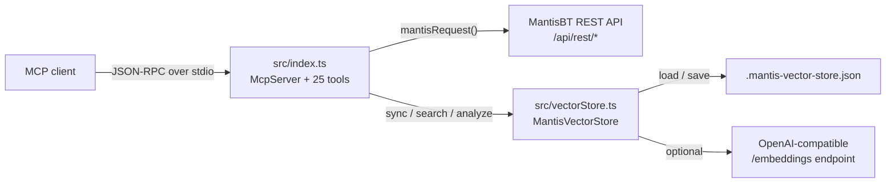

# Architecture

This document describes the internal structure of `mantisbt-mcp-server`: its modules, the request lifecycle, the local vector store, and the design decisions behind them.

## Overview

The server is a single Node.js process that speaks the Model Context Protocol (MCP) over **stdio**. An MCP client (for example, an IDE assistant or Claude Desktop) starts the process, sends JSON-RPC messages on stdin, and reads responses from stdout. The server translates each tool call into one or more calls to the MantisBT REST API, optionally enriches the result with the local vector store, and returns structured JSON.

## Module Layout

| Path | Responsibility |
|------|----------------|
| `src/index.ts` | Entry point. Environment resolution, the HTTP client for MantisBT, data normalization, tool registration, and the stdio transport. |
| `src/vectorStore.ts` | Local vector store: embeddings, cosine similarity, issue metric extraction, persistence, semantic search, and efficiency analytics. |
| `src/test.ts` | Integration tests (`node:test`) that run the MCP server in memory against a mocked MantisBT API. |
| `dist/` | TypeScript build output (generated by `npm run build`, git-ignored). |
| `docs/` | Project documentation and design records. |

## Startup Sequence

1. The client launches `node dist/index.js`.
2. `main()` calls `createMantisMcpServer()`, which constructs an `McpServer` and registers all 25 tools with Zod input schemas.
3. A `StdioServerTransport` is connected. The process then waits for requests.

The `main()` call is guarded so that importing `index.ts` in tests does not start a transport.

## Configuration Resolution

Configuration is resolved lazily, at each tool call, by `resolveEnvVar()`:

1. The value from `process.env` is used when it is non-empty and is not an unexpanded placeholder such as `${MANTIS_API_TOKEN}`. Some MCP clients pass placeholders verbatim when a variable is unset.
2. Otherwise, the value is read from a `.env` file. Only the project root (next to `dist/`) is checked; the working directory is not.
3. Otherwise, the hard-coded default is used.

See [CONFIGURATION.md](CONFIGURATION.md) for the full list of variables.

## MantisBT URL Normalization

Users may configure `MANTIS_BASE_URL` in several forms. `normalizeMantisUrls()` derives two roots from any of them:

| Input | `webRootUrl` | `apiRootUrl` |
|-------|--------------|--------------|
| `https://mantis.example.com` | `https://mantis.example.com` | `https://mantis.example.com/api/rest` |
| `https://mantis.example.com/api/rest` | `https://mantis.example.com` | `https://mantis.example.com/api/rest` |
| `https://mantis.example.com/api/rest/index.php` | `https://mantis.example.com` | `https://mantis.example.com/api/rest/index.php` |

### `index.php` Fallback

Some MantisBT installations do not enable Apache `mod_rewrite`, so `/api/rest/*` returns 404 and only `/api/rest/index.php/*` works. `mantisRequest()` handles this transparently:

1. Send the request to `apiRootUrl`.
2. If the response is 404 and the URL does not already contain `index.php`, retry under `…/index.php`.
3. If the retry does not return 404, remember the web root in an in-memory set so later URLs are built with `index.php` directly.

## HTTP Client (`mantisRequest`)

All MantisBT calls go through one function:

- Adds the `Authorization` header with the API token, plus JSON `Content-Type` and `Accept` headers.
- Builds query strings from an object, dropping `undefined` and empty values.
- Throws a descriptive `Error` on any non-2xx response, including the status, the path, and the response body.
- Uses the global `fetch` available in Node.js 18+. There is no retry or backoff. Callers decide how to handle failures.

## Data Normalization

Raw MantisBT issue payloads are large. Two functions keep LLM context small:

- **`normalizeIssueForLLM(issue, includeHistory)`** flattens references to `{id, name}` pairs, drops binary attachment content (keeping `id`, `filename`, `size_bytes`, `content_type`, and `created_at`), and optionally includes the transition history.
- **`get_issue_attachment`** downloads a specific attachment on demand, so binary data enters the context only when requested.

## Unresolved-Issue Collection

`get_my_unresolved_assigned_context` exists because the MantisBT REST API cannot filter by `handler_id` combined with `status < threshold`. The collection strategy is:

1. Resolve the target user. If `assignee_user_id` is omitted, call `/users/me`.
2. Try the native filter: `filter_id=assigned` (or the supplied `filter_id`).
3. If the native filter is unavailable on this server, fall back to a paginated scan of `/issues`, up to `max_pages` pages of 50 issues.
4. Apply client-side filters: `issue.handler.id === targetUserId` and `issue.status.id < resolved_status_threshold` (default `80`, which is MantisBT's `resolved`; `90` is `closed`).
5. Optionally hydrate each issue with `GET /issues/{id}` when `hydrate_individual_issues` is true, because list endpoints can omit deep fields.
6. Build an executive summary grouped by project, priority, and status.

## Local Vector Store

The vector store is a self-contained, file-backed index. It needs no database server, which keeps installation to a single `npm install` and a stdio command.

### Embeddings

`computeEmbedding()` chooses a mode at call time:

- **Local (default).** `computeLocalEmbedding()` builds a 256-dimensional vector with feature hashing:
  - `tokenizeText()` lowercases text, strips accents, and splits on non-alphanumeric characters.
  - Features are word unigrams, word bigrams, and character trigrams.
  - Each feature is hashed with FNV-1a (seed `2166136261`) to pick one of 256 buckets. A second FNV-1a hash (different seed) gives a +1 or -1 sign, which reduces collision bias.
  - Feature weights are sublinearly scaled (`1 + ln(count)`), and the result is L2-normalized.
  - No model download and no network access are needed.
- **External (optional).** When `MANTIS_EMBEDDING_API_URL`, `MANTIS_EMBEDDING_API_KEY` and `MANTIS_ALLOW_EXTERNAL_EMBEDDINGS=true` are set, the text is sent to an OpenAI-compatible `/embeddings` endpoint using `MANTIS_EMBEDDING_API_KEY` and `MANTIS_EMBEDDING_MODEL`. Dense neural embeddings capture synonyms that hashing cannot, at the cost of network calls and sending issue text to a third party.

Because both modes produce vectors of different dimensions and geometry, a store should be re-synced after changing modes.

### Issue Lifecycle Metrics

`extractIssueMetrics()` turns a MantisBT issue into the telemetry used by analytics:

| Metric | Derivation |
|--------|------------|
| `lead_time_hours` | Time from creation to the first transition into a resolved status. Falls back to `updated_at - created_at` when history is missing and the issue is resolved. |
| `open_age_hours` | Age of an unresolved issue. |
| `staleness_hours` | Hours since the last update, for unresolved issues. |
| `reopen_count` | Number of transitions from resolved back to an open status, taken from history. |
| `reassignment_count` | Number of handler changes, taken from history. |
| `time_tracking_minutes` | Sum of note `time_tracking` durations, parsed by `parseDurationMinutes()`. |
| `is_overdue` | `due_date` is in the past and the issue is unresolved. |

### Record Schema

Each indexed issue is stored as a `VectorIssueRecord` containing identifiers and names, timestamps, tags, the `metrics` object above, the concatenated `document_text` used for embedding, the `vector`, and `indexed_at`.

### Persistence

`MantisVectorStore` keeps records in memory and writes the whole file on save. The path is `MANTIS_VECTOR_DB_PATH`, or `.mantis-vector-store.json` in the working directory. Loading an absent file starts an empty store. The file is git-ignored, since it contains issue content.

### Semantic Search

`search()` ranks records by cosine similarity between the query vector and each record vector. Results can be narrowed by `project_id`, `handler_id`, `only_unresolved`, and `min_similarity` (default `0.05`). The top `top_k` results (default `10`, maximum `50`) are returned.

### Efficiency Analytics

`analyzeEfficiency()` runs the following stages:

1. **Filter** records by project and handler.
2. **Throughput and lead time.** Resolution rate, mean lead time, P50, and P90 (`percentile()` over sorted values).
3. **Friction.** Reopen rate, average reassignments per issue, stagnant issues (`staleness_hours >= stale_threshold_hours`, default 168 hours), and overdue issues.
4. **Per-developer breakdown.** Open versus resolved load, stagnation, reopens, and mean lead time per assignee.
5. **Semantic clusters.** Greedy, seed-based clustering over the first `max_cluster_items` records of the filtered set (default `300`, which bounds the O(N²) cost). Each unvisited record becomes a seed. Every other unvisited record whose cosine similarity *to the seed's vector* is at or above `cluster_similarity_threshold` (default `0.38`) joins that seed's cluster. Clusters are sorted by unresolved count.
6. **Score and diagnostics.** The score starts at 100 and subtracts capped penalties for reopen rate, assignment ping-pong, stagnation, low resolution rate, overdue and unassigned work, and open semantic clusters. Each penalty that applies also produces a rule-based diagnostic message (for example, "High assignment ping-pong" or "Healthy flow").

Scoring is deterministic: the same data always produces the same score, which makes results comparable over time.

## Error Handling

- Tool handlers wrap their work in `try/catch`. Errors are returned as MCP tool results marked `isError: true`, with the message in JSON. They are not thrown to the transport, so the server keeps running.
- Input is validated by Zod before the handler runs. Invalid arguments produce a structured validation error.
- Fatal startup errors are logged to stderr, and the process exits with code 1. stdout is reserved for the MCP protocol, so diagnostics go to stderr only.

## Design Decisions

| Decision | Rationale | Alternatives rejected |
|----------|-----------|-----------------------|
| stdio transport | Works with any MCP client without ports, daemons, or TLS setup. | HTTP/SSE server |
| File-backed vector store | Zero external services; one JSON file per project. | Qdrant, Chroma, pgvector (require a server) |
| Feature-hashed local embeddings by default | Deterministic, offline, no model download. | Bundled transformer models (large, slow to install) |
| Pure TypeScript numeric arrays | Native C++ vector libraries have fragile prebuilt binaries across Node.js ABI versions on Windows. | `hnswlib-node`, `faiss-node` |
| Greedy seed-based clustering with a cap | Simple, and bounded in cost by `max_cluster_items`. | Full pairwise clustering over all issues |
| Client-side status and handler filtering | The REST API does not support the combined filter. | Assuming server-side support |

Related design records are in [designs/](designs/).

## Known Limitations

- The vector store loads and saves the entire file. This is suitable for thousands of issues, not millions.
- `index.php` fallback state is per process. After a restart, the first request to a no-rewrite server pays one extra round trip.
- The local embedding model captures lexical overlap, not meaning. Synonyms with no shared characters are not matched unless an external embedding API is configured.
- Changing embedding mode requires re-running `sync_issues_to_vector_store`.
