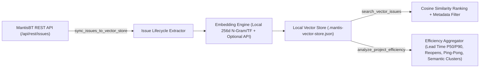

# Design Specification: Vector Knowledge Store & Project Efficiency Analytics for MantisBT MCP

## 1. The Problem

MantisBT stores issue data as isolated tickets accessible only through paginated REST endpoints (`/api/rest/issues`) with limited filtering (`project_id`, `filter_id`). Engineering leads and LLMs using MantisBT lack two capabilities:
1. **Semantic Retrieval**: Finding historically similar issues, duplicate bugs, or recurring root causes across projects when exact keywords differ.
2. **Project Efficiency Diagnostics**: Measuring lead time (P50/P90), handler ping-pong (reassignments), reopen rates, stale work-in-progress, and semantic clusters of recurring bottlenecks without exporting data to external BI pipelines.

## 2. Overview

This feature embeds a local vector knowledge store (`src/vectorStore.ts`) into `mantisbt-mcp-server` and exposes three MCP tools (`sync_issues_to_vector_store`, `search_vector_issues`, `analyze_project_efficiency`). Issues fetched from MantisBT are converted into normalized lifecycle records, embedded into L2-normalized vectors (via a zero-dependency local feature-hashed TF-IDF/n-gram vectorizer or an optional OpenAI-compatible `/embeddings` endpoint), persisted to disk, and analyzed to produce quantitative and semantic efficiency reports.

## 3. Goals & Non-Goals

### Goals
- Provide a self-contained vector store persisted on disk (`.mantis-vector-store.json` or `MANTIS_VECTOR_DB_PATH`) requiring no external database server.
- Compute deterministic local embeddings (`dim = 256`) out of the box, with optional HTTP embedding API support (`MANTIS_EMBEDDING_API_URL`).
- Extract per-issue efficiency telemetry from MantisBT fields and history (`lead_time_hours`, `open_age_hours`, `staleness_hours`, `reopen_count`, `reassignment_count`, `time_tracking_minutes`).
- Cluster semantically similar issues using cosine similarity to surface recurring engineering bottlenecks and duplicate work.
- Expose MCP tools for synchronization, semantic search, and full project efficiency analysis.

### Non-Goals
- Replacing dedicated distributed vector databases (Milvus, Qdrant, pgvector) for multi-million-ticket deployments.
- Mutating MantisBT issues automatically based on efficiency scores without explicit operator tool calls.

## 4. Goldfish Stress-Test: Risks & Counter-Arguments

1. **Risk: Local Feature-Hashed Embeddings vs. Deep Transformer Embeddings**
   - *Critique*: Feature-hashed n-gram/token vectors do not capture cross-lingual synonyms unless terms or character n-grams overlap.
   - *Mitigation*: Combine word unigrams, word bigrams, and character trigrams with sublinear TF scaling and L2 normalization for offline operation, while supporting an optional external `/embeddings` HTTP endpoint (`MANTIS_EMBEDDING_API_URL`, `MANTIS_EMBEDDING_API_KEY`, `MANTIS_EMBEDDING_MODEL`) when dense neural embeddings are required.
2. **Risk: O(N²) Pairwise Clustering Cost**
   - *Critique*: All-pairs cosine similarity across tens of thousands of issues can block the Node.js event loop.
   - *Mitigation*: Bound clustering to the active project slice (default cap `max_cluster_items = 500` most recent/relevant issues) using flat `Float64Array`/number arrays and single-pass greedy centroid clustering.
3. **Risk: Incomplete History on List Endpoint**
   - *Critique*: Some MantisBT configurations omit transition `history` on `GET /api/rest/issues` list calls.
   - *Mitigation*: Fallback lead-time calculation uses `updated_at - created_at` whenever `status.id >= resolved_status_threshold` and explicit history transitions are absent; optional `hydrate_individual_issues: true` fetches full per-issue history when exact transition counts are required.

## 5. Technical Plan

### Data Schema (`VectorIssueRecord`)
- `id`: MantisBT issue ID (`number`)
- `project_id` / `project_name`: Project identifiers
- `category`: Category name
- `summary`: Issue title
- `status_id` / `status_name`: Current workflow status
- `priority_id` / `priority_name`: Priority metadata
- `severity_id` / `severity_name`: Severity metadata
- `handler_id` / `handler_name`: Assignee metadata
- `reporter_id` / `reporter_name`: Reporter metadata
- `created_at` / `updated_at` / `due_date`: ISO-8601 timestamps
- `tags`: Tag names (`string[]`)
- `metrics`:
  - `is_resolved`: `boolean`
  - `lead_time_hours`: `number | null`
  - `open_age_hours`: `number`
  - `staleness_hours`: `number`
  - `reopen_count`: `number`
  - `reassignment_count`: `number`
  - `note_count`: `number`
  - `time_tracking_minutes`: `number`
  - `is_overdue`: `boolean`
- `document_text`: Concatenated semantic text indexed for search
- `vector`: `number[]` (L2-normalized embedding vector)
- `indexed_at`: ISO-8601 timestamp

## 6. Alternatives Considered

- **External Qdrant / Chroma Server**: Rejected as default because requiring a Docker container or separate daemon breaks single-command stdio MCP installation.
- **Native C++ Addons (`hnswlib-node`, `faiss-node`)**: Rejected because prebuilt binaries frequently fail across Windows/Node.js ABI upgrades. Pure TypeScript over typed arrays handles thousands of MantisBT issues in milliseconds.

## 7. Detailed Implementation

1. `./src/vectorStore.ts` *(Create)*: Implements `computeEmbedding`, `cosineSimilarity`, `extractIssueMetrics`, `MantisVectorStore` (load, save, upsertIssues, search, analyzeEfficiency).
2. `./src/index.ts` *(Modify)*: Registers `sync_issues_to_vector_store`, `search_vector_issues`, and `analyze_project_efficiency` on `McpServer`.
3. `./src/test.ts` *(Modify)*: Adds deterministic tests covering vector indexing, semantic similarity ranking, and project efficiency diagnostics (lead time, reopen rate, assignee bottlenecks, semantic clusters, and efficiency score).
4. `./README.md` *(Modify)*: Documents the new vector store and efficiency analysis tools and environment variables.
